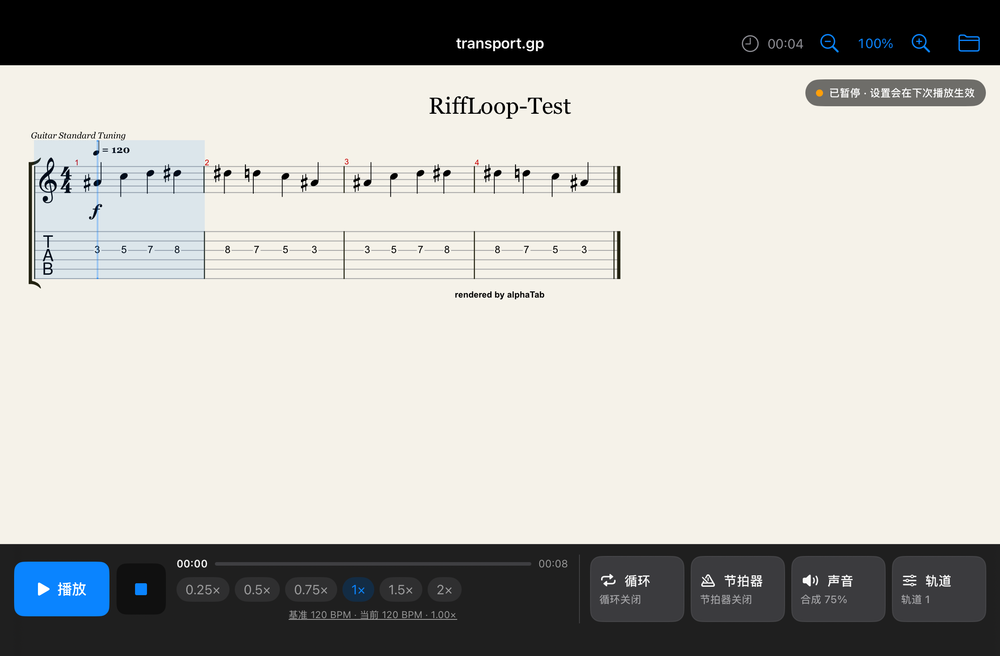
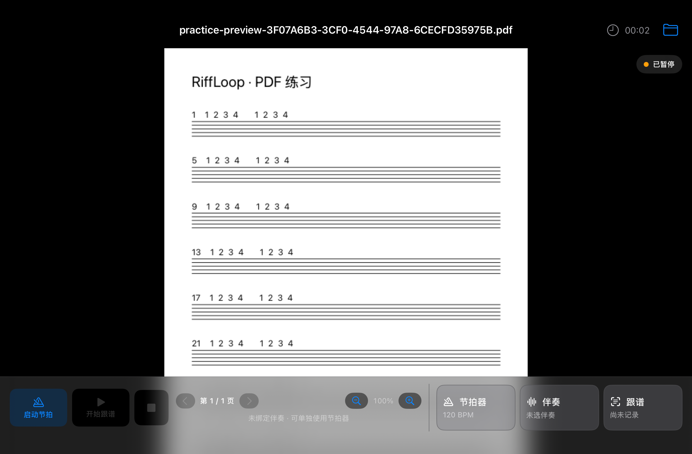
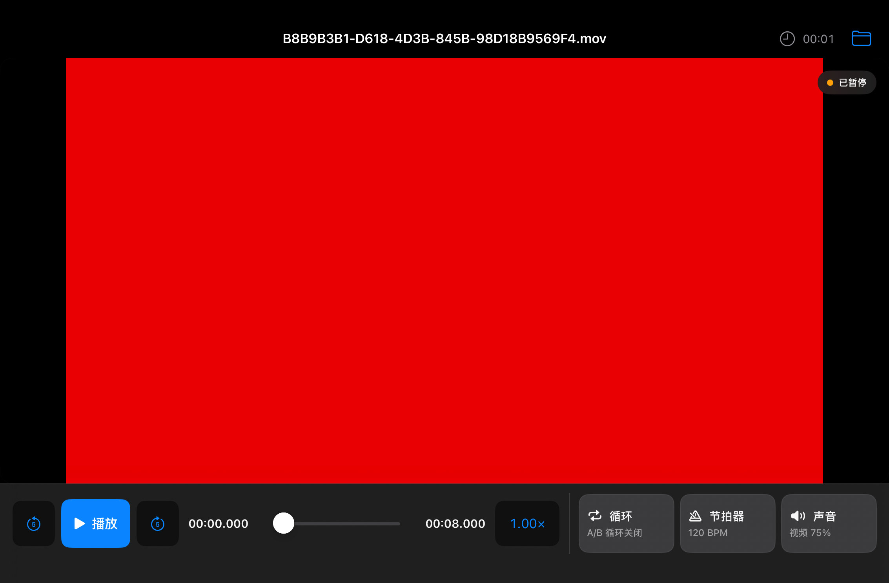

# 2026-10-15 iOS 接手记录

## 位置与版本
- 实际工作树：C:/Users/sadada/.codex/worktrees/riffloop-practice-controls-20261015
- 分支：codex/ipad-practice-controls-20261015
- 桌面 C:/Users/sadada/Desktop/ipad 节拍器 是旧 checkout；不要直接在那里重做这轮修改。
- 候选版本：0.25.65（109），产品提交 7ce769517cddfc33fb8bccf60911c2c1450156e9。
- 接手时真机仍为 0.25.64（108），ProfileValidated=true。

## 最终需求及实现
- GP 点谱：从所选位置继续播放，音乐、节拍和光标一起跳转。视口内的目标不立即强制居中；手动翻谱后选中则平滑定位。
- 只翻谱不暂停、不跳转声音；停止操作约 3 秒后平滑回到播放位置。可以完整显示的循环区域维持整组居中。
- GP 提供直接输入 BPM、±1 调整及 0.25–2×快捷倍速；受引擎有效倍速边界约束，原谱速度变化按比例保留。
- 独立节拍器和正常 GP 播放互斥；节拍器可单独设置 BPM、每小节拍数及音量，谱面保持静止。
- 系统中断后，仅中断前正在播放、系统允许、原输出相同且应用回到活跃状态时恢复。手动暂停、退出、进入后台或音响断开会取消恢复。
- PDF 只显示小节内拍点，移除无限累计的小节数。
- 用户再次确认：计时从进入练习页面开始，暂停时继续。GP/PDF/视频顶部工具栏显示，不遮住内容；返回主页再进入为新一轮，换文件不重置。
- 原来的实际播放时长历史独立保留，GP 独立节拍器播放也计入该历史。

## 接手后发现并修复
- 旧页面会把暂时 inactive 当作后台暂停，取消系统中断恢复；现在只有实际 background 会这样处理。
- 手动翻谱后返回忽略短循环整组居中；现在保留循环目标位置。
- 手指打断平滑动画后同一行不会重新跟随；现在释放后可继续。
- 倍速因引擎边界产生非预设值时，Picker 需要保留当前有效值。
- 新的系统中断会撤销上一次等待激活的恢复许可，防止还在中断时误启动。

## 验证记录
- 五组本地播放回归、发布流程 7 场景及 IPA 校验 6 项通过。
- 首轮 CI 38699857444：编译通过，164 项 Swift 测试中一个测试的两处断言失败。原因是测试将 inactive 与 background 混用，导致场景状态残留；已修正并增加连续中断测试。GP WebKit 播放、PDF/视频及页面渲染测试均通过。
- 第二轮 CI 38701187923 被新的计时显示修复提交替代并取消，未作为通过证据。
- 最终 CI：https://github.com/xudadasf/RiffLoop/actions/runs/38702160712 ，165 项 Swift 测试全部通过（0 failures），本地播放规则和发布安全检查也通过。
- 截图复核发现工具栏默认隐藏计时数字，7ce7695 强制同时显示图标和数字，最终三模式截图确认修复。
- IPA 构建：https://github.com/xudadasf/RiffLoop/actions/runs/38703590025 ，成功，绑定同一产品提交；已下载并通过包内版本、平台、Bundle ID、SHA-256 和侧载 DryRun 校验。
- 真实音响输出、长时间稳定性及触摸滚动体验仍需真机验收；不将模拟器通过描述为彻底消除了系统音频中断。

## 页面截图
以下均来自最终 CI 的 iPad mini 模拟器与测试素材，不包含用户谱面。

## 安装包与当前设备状态
- 安装包：`output/release-0.25.65-build109-7ce7695/RiffLoop-iPad-0.25.65-unsigned-arm64.ipa`。
- `build-info.json` 必须随包保留，构建来源同时归档在 `docs/releases/0.25.65-build-info.json`。
- SHA-256：`070a7df7c417c02b35c62416b1da49596773b77855dc783dc2c41baa0f8c0500`。
- 2026-10-15 16:36（北京时间）已原账号覆盖安装，设备读取 0.25.65（109），签名有效；原 Bundle ID 不变。未卸载、未清数据。
- 安装前后首次启动前，14 个 Documents 文件（169,785,536 字节）大小和 SHA-256 全部一致。应用启动及首页抽查通过，自动续签登记已更新。
- 安装过程的 Windows 应用包身份问题、处理方式及验证边界见 [真机安装记录](2026-10-15-device-install.md)。
- 仍需实测 Spark MINI USB 输出、暂停/继续、切换独立节拍器、跳转、变速、循环和手动翻谱，并进行持续播放观察；不将启动抽查等同于真机稳定性验收。
